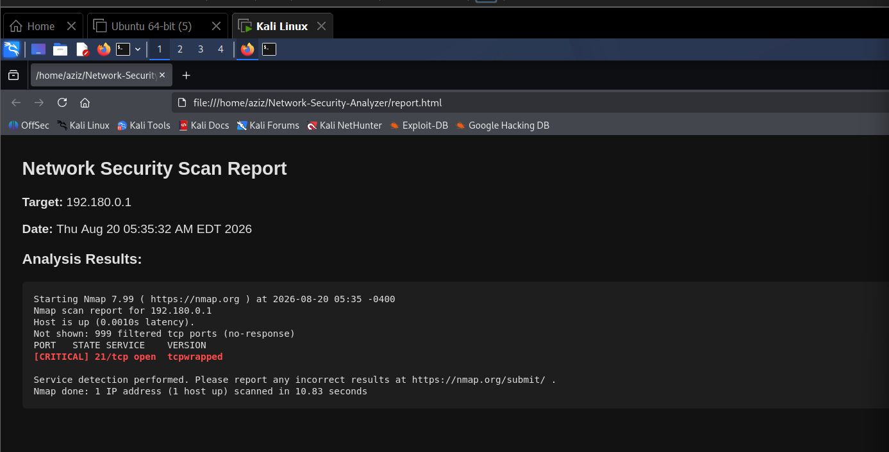
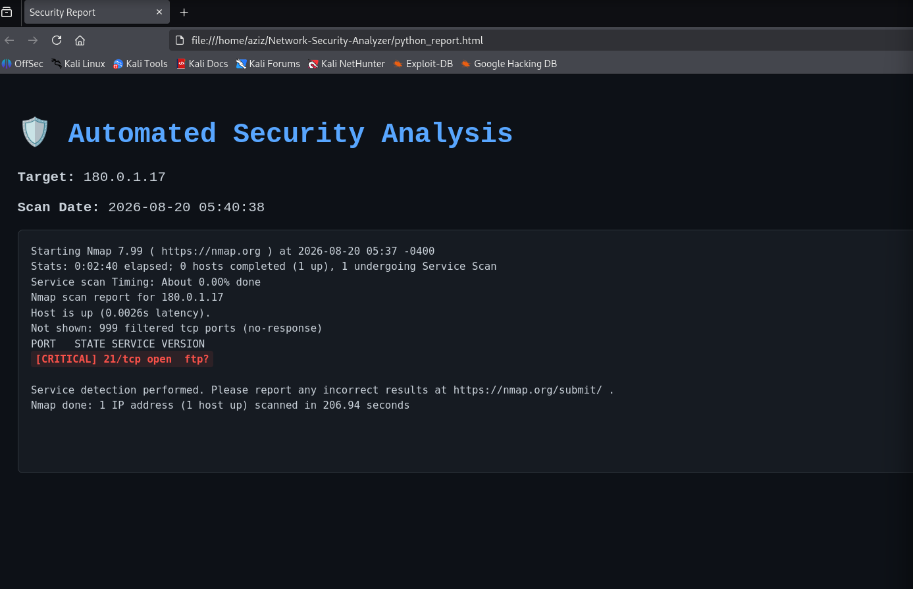

# Advanced Network Security Analyzer

[](https://github.com/Eng-Abdulaziz-Asiri/Network-Security-Analyzer/actions/workflows/ci.yml)
[](https://python.org)
[](https://gnu.org/software/bash)
[](https://nmap.org)
[](LICENSE)

An automated, dual-language (Python & Bash) network reconnaissance tool that runs Nmap scans, analyzes open ports for potential risks, and generates a professional dark-themed HTML security report.

## Key Features

- **Dual Implementation:** Available in both Bash and Python.
- **Input Validation:** RegEx validation to ensure only valid IPv4/subnet targets.
- **Risk Profiling:** Categorizes ports into Critical, Warning, and Open.
- **HTML Reporting:** Generates a clean dark-themed report automatically.
- **Automated Testing:** Every push is tested with GitHub Actions.

## Quick Start (Easiest Way)

Clone the repo and run the launcher. It installs Nmap automatically if it's missing, lets you pick the Bash or Python version, and opens the report for you when the scan finishes:

```bash
git clone https://github.com/Eng-Abdulaziz-Asiri/Network-Security-Analyzer.git
cd Network-Security-Analyzer
bash run.sh
```

That's it — no manual installation or setup steps needed.

## Manual Steps (Advanced)

If you'd rather run each version yourself:

### Bash version (lightweight)
```bash
chmod +x analyzer.sh
sudo ./analyzer.sh
```
> After the scan completes, open the report in Firefox:
> ```bash
> firefox report.html &
> ```

### Python version (recommended)
```bash
sudo python3 py_analyzer.py
```
> After the scan completes, open the report in Firefox:
> ```bash
> firefox python_report.html &
> ```

## Report Preview

### Bash Report


### Python Report


## Risk Categories

| Level | Ports | Reason |
|-------|-------|--------|
| **Critical** | 21 (FTP), 23 (Telnet), 139 & 445 (SMB), 3389 (RDP) | Highly exploitable protocols |
| **Warning**  | 80 (HTTP), 8080 (HTTP-alt), 25 (SMTP), 110 (POP3), 3306 (MySQL) | Commonly targeted services |
| **Open**     | Any other open port | No known critical risk |

## How it Works

1. **Input Validation** — Verifies the target is a valid IPv4 or subnet.
2. **Reconnaissance** — Runs `nmap -sV` to detect open ports and services.
3. **Analysis** — Compares discovered ports against a threat matrix.
4. **Report** — Generates a color-coded HTML report for quick triage.

## Automated Testing (CI)

On every push, [GitHub Actions](.github/workflows/ci.yml) runs the full tool on a fresh Linux machine:

- Lints both scripts (`bash -n`, ShellCheck, `py_compile`)
- Starts a test web service on `localhost:8080`
- Scans **localhost only** with both the Python and Bash versions, and checks that port 8080 is reported as **Warning**
- Checks that invalid targets (e.g. `not-an-ip`) are rejected
- Runs the one-command launcher `run.sh`
- Uploads the generated HTML reports as downloadable artifacts

## Prerequisites

- Linux OS
- Python 3
- Nmap (installed automatically by `run.sh`)

```bash
sudo apt update && sudo apt install nmap -y
```

## Legal Notice

This tool is intended for **educational and authorized use only.**
Only scan networks you own or have **explicit permission** to test.
Unauthorized scanning may violate local laws.
